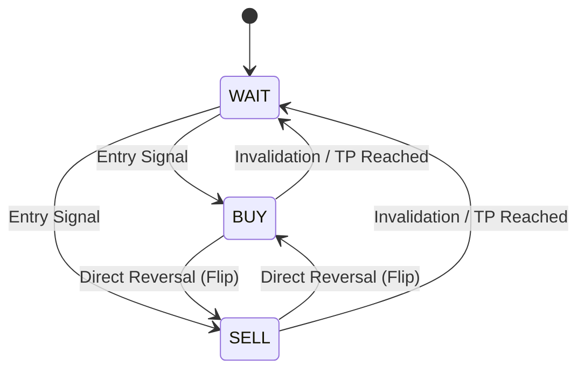

# MQL Notification & Alerting Engine (Telegram & LINE)

This skill provides production standards, code patterns, and finite state machine (FSM) architectures for transmitting real-time trading alerts from **MetaTrader 4 (MQL4)** and **MetaTrader 5 (MQL5)** directly to **Telegram** and **LINE** using native `WebRequest()` without any external DLLs.

---

## 1. Core API Protocols & Endpoints

### ✈️ Telegram Bot API
- **Endpoint**: `https://api.telegram.org/bot<TOKEN>/sendMessage`
- **HTTP Method**: `POST`
- **Content-Type**: `application/x-www-form-urlencoded`
- **Payload Format**: `chat_id=<CHAT_ID>&text=<URL_ENCODED_TEXT>&parse_mode=HTML`
- **Parse Mode**: `HTML` (allows `<b>`, `<i>`, `<code>`, `<pre>`)
- **Rate Limit**: Max 30 messages/second across all chats, max 1 message/second to a single chat/group.

### 💬 LINE Messaging API (Post-March 2025 Standard)
> [!IMPORTANT]
> **LINE Notify Sunset**: LINE Notify was officially terminated on March 31, 2025. All modern integrations MUST use the **LINE Messaging API** via LINE Official Account (Channel Access Token).
- **Endpoint**: `https://api.line.me/v2/bot/message/push`
- **HTTP Method**: `POST`
- **Headers**:
  ```http
  Content-Type: application/json
  Authorization: Bearer <CHANNEL_ACCESS_TOKEN>
  ```
- **Payload Format (JSON)**:
  ```json
  {
    "to": "<USER_OR_GROUP_ID>",
    "messages": [
      {
        "type": "text",
        "text": "<ALERT_MESSAGE>"
      }
    ]
  }
  ```

---

## 2. MetaTrader Terminal Whitelist Requirement

Both MT4 and MT5 sandbox `WebRequest()` for security. The terminal MUST have the target API domains explicitly whitelisted:
1. In MetaTrader: `Tools` $\rightarrow$ `Options` $\rightarrow$ `Expert Advisors`.
2. Check `[x] Allow WebRequest for listed URL:`.
3. Add the exact URLs:
   - `https://api.telegram.org`
   - `https://api.line.me`

---

## 3. Finite State Machine (FSM) Transition Matrix

A naive alert check (`if (oldState == "WAIT" && newState == "BUY")`) fails to catch sudden market reversals. The engine MUST evaluate all valid transitions in the state matrix:



| Transition | Event Type | Notification Action & Tag | Priority |
| :--- | :--- | :--- | :---: |
| `WAIT` $\rightarrow$ `BUY` | **New Entry** | 🟢 **NEW BUY SIGNAL**: Entry, SL, TP, Confluence | High |
| `WAIT` $\rightarrow$ `SELL` | **New Entry** | 🔴 **NEW SELL SIGNAL**: Entry, SL, TP, Confluence | High |
| `BUY` $\rightarrow$ `SELL` | **Direct Reversal** | 🔄 **TREND REVERSAL (FLIP)**: Close BUY, Open SELL | Critical |
| `SELL` $\rightarrow$ `BUY` | **Direct Reversal** | 🔄 **TREND REVERSAL (FLIP)**: Close SELL, Open BUY | Critical |
| `BUY` $\rightarrow$ `WAIT` | **Signal Invalidation** | 🟡 **SIGNAL INVALIDATED / CLOSED**: Trend structure reset | Medium |
| `SELL` $\rightarrow$ `WAIT` | **Signal Invalidation** | 🟡 **SIGNAL INVALIDATED / CLOSED**: Trend structure reset | Medium |

---

## 4. Anti-Spam & Rate Limiting Guardrails

1. **New Bar Latch**: Only dispatch signal entry/exit alerts when a new bar forms on the trigger timeframe (e.g., M15), unless a critical stop-out or direct reversal flips intra-bar.
2. **Cooldown Timer**: Enforce a mandatory minimum interval (e.g. 10–30 seconds) between successive `WebRequest()` calls to prevent terminal UI thread stutter and API 429 throttling.
3. **State Change Memoization**: Track `g_lastAlertDecision` so repeated ticks with identical state do not trigger HTTP requests.

---

## 5. Pure MQL Native Helper Implementation Patterns

### A. URL Encoding (Pure MQL, Zero DLL)
```mql4
string UrlEncode(const string str)
{
   string result = "";
   uchar bytes[];
   StringToCharArray(str, bytes, 0, WHOLE_ARRAY, CP_UTF8);
   int len = ArraySize(bytes) - 1; // Exclude null terminator
   for(int i = 0; i < len; i++)
   {
      uchar c = bytes[i];
      if((c >= 'a' && c <= 'z') || (c >= 'A' && c <= 'Z') || (c >= '0' && c <= '9') ||
         c == '-' || c == '_' || c == '.' || c == '~')
      {
         result += CharToString((char)c);
      }
      else
      {
         result += StringFormat("%%%02X", c);
      }
   }
   return result;
}
```

### B. Telegram Dispatcher (`WebRequest`)
```mql4
bool SendTelegramAlert(const string token, const string chatId, const string message)
{
   if(token == "" || chatId == "") return false;
   string url = "https://api.telegram.org/bot" + token + "/sendMessage";
   string headers = "Content-Type: application/x-www-form-urlencoded\r\n";
   string postData = "chat_id=" + chatId + "&text=" + UrlEncode(message) + "&parse_mode=HTML";

   char data[];
   char result[];
   string resultHeaders;
   StringToCharArray(postData, data, 0, WHOLE_ARRAY, CP_UTF8);
   ArrayResize(data, ArraySize(data) - 1);

   ResetLastError();
   int res = WebRequest("POST", url, headers, 3000, data, result, resultHeaders);
   if(res == 200) return true;

   PrintFormat("[Telegram] Error HTTP code %d, LastError = %d", res, GetLastError());
   return false;
}
```

### C. LINE Messaging API Dispatcher (`WebRequest`)
```mql4
bool SendLineAlert(const string channelToken, const string userId, const string message)
{
   if(channelToken == "" || userId == "") return false;
   string url = "https://api.line.me/v2/bot/message/push";
   string headers = "Content-Type: application/json\r\nAuthorization: Bearer " + channelToken + "\r\n";
   
   // Escape JSON characters
   string escaped = message;
   StringReplace(escaped, "\\", "\\\\");
   StringReplace(escaped, "\"", "\\\"");
   StringReplace(escaped, "\r", "");
   StringReplace(escaped, "\n", "\\n");

   string json = StringFormat("{\"to\":\"%s\",\"messages\":[{\"type\":\"text\",\"text\":\"%s\"}]}", userId, escaped);

   char data[];
   char result[];
   string resultHeaders;
   StringToCharArray(json, data, 0, WHOLE_ARRAY, CP_UTF8);
   ArrayResize(data, ArraySize(data) - 1);

   ResetLastError();
   int res = WebRequest("POST", url, headers, 3000, data, result, resultHeaders);
   if(res == 200) return true;

   PrintFormat("[LINE] Error HTTP code %d, LastError = %d", res, GetLastError());
   return false;
}
```
